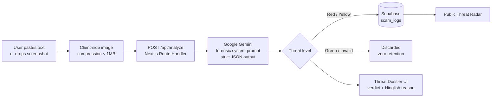

<div align="center">

# 🛡️ Vernacular Scam Analyzer

### AI-powered scam detection that speaks the language of Bharat.

Paste a suspicious SMS or WhatsApp message, or drop a screenshot, and get a clear **Red / Yellow / Green** verdict with a one-line explanation in simple Hinglish, in seconds.

[](https://qash-scam-analyzer.vercel.app/)
[](https://github.com/AshQ-ghbi/Qash-scam-analyzer)


**Hack for Social Case · Think Global, Hack Local**
Aligned with **UN SDG 9** (Industry, Innovation & Infrastructure) and **UN SDG 16** (Peace, Justice & Strong Institutions)

</div>

---

## 📌 Table of Contents

- [The Problem](#-the-problem)
- [Our Solution](#-our-solution)
- [Key Features](#-key-features)
- [How It Works](#-how-it-works)
- [Tech Stack](#-tech-stack)
- [Project Structure](#-project-structure)
- [Getting Started](#-getting-started)
- [Environment Variables](#-environment-variables)
- [Privacy by Design](#-privacy-by-design)
- [Design System](#-design-system)
- [Social Impact & SDG Alignment](#-social-impact--sdg-alignment)
- [Roadmap](#-roadmap)
- [Team](#-team)
- [License](#-license)

---

## 🚨 The Problem

Digital payments and smartphones have reached millions of first-time users across Tier-2 and Tier-3 India. Scammers have followed them, and they write in the languages people actually use:

- **"Aapki bijli aaj raat kat jayegi"**: fake electricity disconnection notices
- **"Aapne KBC lottery jeeti hai"**: advance-fee lottery fraud
- **"Aapka KYC expire ho gaya"**: bank and KYC phishing
- **Digital arrest, fake parcels, work-from-home job fees, UPI "refund" tricks**

Most scam-detection tools are built for English-speaking users and rely on technical jargon. The people most at risk are often **first-generation smartphone users** who cannot tell a fake SMS from a real one, and who need an answer **in their own language, right now**, before they click or send money.

## 💡 Our Solution

**Vernacular Scam Analyzer** is a free, no-login web tool that acts as a pocket cyber-forensic analyst. Users paste a message or upload a screenshot, and an AI model trained through careful prompting to recognise Indian scam patterns returns:

1. A clear **threat level**: 🔴 Red (scam) · 🟡 Yellow (suspicious) · 🟢 Green (likely safe)
2. A **one-sentence explanation in simple Hinglish**, so anyone can understand *why*
3. A direct path to **report the scam** to the official cybercrime helpline (**1930**)

It also gives the community a **public Threat Radar** of recently intercepted scams, so people can learn from what others are seeing right now.

---

## ✨ Key Features

| Feature | What it does |
|---|---|
| 🔍 **Live Scanner** | Paste text, paste or drag-and-drop a screenshot, or upload a `.txt` file. Images are compressed client-side to under 1 MB before analysis. |
| 🗣️ **Vernacular AI Analysis** | Understands Hinglish, Hindi (Roman or Devanagari) and English, and replies in plain Hinglish. |
| 📸 **Screenshot Understanding** | Multimodal analysis reads the message straight from a WhatsApp or SMS screenshot. |
| 📡 **Threat Radar** | A public, filterable feed (All / Critical / Suspicious) of recently flagged scams, stored in Supabase. |
| 📚 **Scam Library** | Six of the most common Indian scam tactics (KBC lottery, electricity disconnection, KYC and bank block, job fraud, parcel and digital arrest, UPI refund) with red flags, safe actions and example messages. |
| 🚨 **Report a Scam** | Builds a ready-to-paste report and lists official helplines. India (1930 and cybercrime.gov.in) plus the US, UK, Canada, Australia and Singapore. |
| 🌗 **Light and Dark Themes** | "Civic Trust" light mode and "Midnight" dark mode, with a one-click toggle. |
| 🛟 **Graceful Failure** | An 8-second AI timeout falls back to a safe "Yellow: verify manually" result, so the user is never left stuck. |

---

## ⚙️ How It Works



1. **Input:** the user submits text and/or an image. Images are compressed in the browser first.
2. **Analysis:** the server sends the content to **Google Gemini** with a forensic system prompt tuned for Indian scam patterns, and requests **strict JSON**.
3. **Validation:** the response is normalised and validated. Malformed output, a timeout or an API failure returns a safe fallback.
4. **Verdict:** the UI renders a colour-coded **Threat Dossier** with a one-line Hinglish explanation.
5. **Community protection:** only **Red and Yellow** results are logged to Supabase and shown on the public Radar.

---

## 🧰 Tech Stack

| Layer | Technology |
|---|---|
| **Framework** | Next.js 14 (App Router), React 18, TypeScript |
| **Styling** | Tailwind CSS 3 with CSS-variable theme tokens, `next-themes` |
| **AI** | Google Gemini (`gemini-2.5-flash`) via `@google/genai`, multimodal, JSON-mode |
| **Database** | Supabase (PostgreSQL) with Row Level Security |
| **UI utilities** | `lucide-react`, `sonner` (toasts), `browser-image-compression` |
| **Hosting** | Vercel |
| **Fonts** | Outfit (headings), DM Sans (body), Fira Code (message and forensic text) |

---

## 🗂️ Project Structure

```
Qash-scam-analyzer/
├── app/
│   ├── api/analyze/route.ts   # AI analysis endpoint (timeout, validation, privacy-aware logging)
│   ├── radar/page.tsx         # Public threat feed (server component)
│   ├── learn/page.tsx         # Scam tactics library
│   ├── report/page.tsx        # Report form + official helplines
│   ├── about/page.tsx         # Team
│   ├── legal/page.tsx         # Privacy Policy & Terms
│   ├── layout.tsx             # Fonts, theme provider, navbar, footer
│   ├── page.tsx               # Home: live scanner
│   └── globals.css            # Design tokens (light/dark)
├── components/
│   ├── ScannerUI.tsx          # Input, drag-and-drop, paste, compression, scan animation
│   ├── ThreatDossier.tsx      # Verdict card
│   ├── RadarCard.tsx          # Single intercepted-scam card
│   ├── RadarFeed.tsx          # Filter tabs + grid
│   ├── Navbar.tsx             # Floating pill navigation + theme toggle
│   └── ThemeProvider.tsx
├── lib/
│   ├── geminiClient.ts        # Gemini client + forensic system prompt
│   └── supabaseClient.ts      # Supabase client + types
├── schema.sql                 # Table, RLS policies, demo seed data
└── tailwind.config.ts
```

---

## 🚀 Getting Started

### Prerequisites

- Node.js 18.17 or later
- A free [Supabase](https://supabase.com) project
- A [Google AI Studio](https://aistudio.google.com) API key for Gemini

### 1. Clone and install

```bash
git clone https://github.com/AshQ-ghbi/Qash-scam-analyzer.git
cd Qash-scam-analyzer
npm install
```

### 2. Set up the database

Open the **Supabase SQL Editor** and run the contents of [`schema.sql`](./schema.sql). It creates the `scam_logs` table, enables Row Level Security, restricts anonymous users to `SELECT` and `INSERT` only, and seeds the Radar with demo data.

### 3. Configure environment variables

Create a `.env.local` file in the project root (see below).

### 4. Run locally

```bash
npm run dev
```

Open [http://localhost:3000](http://localhost:3000).

### 5. Deploy

Push to GitHub, import the repo into [Vercel](https://vercel.com), and add the same three environment variables in **Project Settings → Environment Variables**.

---

## 🔐 Environment Variables

```bash
NEXT_PUBLIC_SUPABASE_URL=https://YOUR_PROJECT_ID.supabase.co
NEXT_PUBLIC_SUPABASE_ANON_KEY=YOUR_SUPABASE_ANON_KEY
GEMINI_API_KEY=YOUR_GEMINI_API_KEY
```

> `GEMINI_API_KEY` is used **server-side only** and is never exposed to the browser. Never commit `.env.local`.

---

## 🔒 Privacy by Design

We built this for people who are already being targeted, so we collect as little as we can.

- **No accounts, no sign-up, no tracking cookies.**
- **Zero retention for safe and invalid messages:** results classified **Green** or **Invalid** are *never* stored.
- **Only Red and Yellow results are logged**, as text, verdict, reasoning and timestamp. Screenshots themselves are never saved.
- **Append-only database:** Row Level Security gives anonymous users `SELECT` and `INSERT` only. `UPDATE` and `DELETE` are blocked and their grants revoked.
- **The report form never touches our server.** Your report is copied to your own clipboard.
- A full [Privacy Policy and Terms](https://qash-scam-analyzer.vercel.app/legal) page is included.

---

## 🎨 Design System

| Token | Light: "Civic Trust" | Dark: "Midnight" |
|---|---|---|
| Background | `#F8F9FA` | `#0A0A0A` |
| Primary | `#F97316` (saffron orange) | `#EF4444` |
| Accent (scanner) | `#06B6D4` | `#06B6D4` |
| Threat colours | 🔴 `#EF4444` · 🟡 `#EAB308` · 🟢 `#22C55E` | same |

Pill-shaped floating navigation, rounded-3xl cards, hover-lift micro-interactions and a laser-scan animation while the AI works.

<!--
  TODO before submission: add screenshots / a demo GIF here, e.g.
  
  
-->

---

## 🌍 Social Impact & SDG Alignment

| SDG | How we contribute |
|---|---|
| **SDG 9: Industry, Innovation & Infrastructure** | Brings affordable, AI-powered digital-safety infrastructure to users beyond English-speaking metros. |
| **SDG 16: Peace, Justice & Strong Institutions** | Reduces fraud, helps victims reach official channels (1930 and cybercrime.gov.in) faster, and builds public awareness of scam tactics. |

**Who it helps:** first-time smartphone users, senior citizens, rural and small-town families, and anyone who gets a message they are not sure about and has nobody to ask.

---

## 🗺️ Roadmap

- [ ] Native Hindi (Devanagari) and regional-language responses: Marathi, Tamil, Telugu, Bengali
- [ ] Voice input and read-aloud results for low-literacy users
- [ ] WhatsApp / Telegram bot for in-chat scanning
- [ ] URL and phone-number reputation checks
- [ ] Browser extension and Android share-sheet integration
- [ ] Anonymised scam-trend analytics dashboard for cyber-cells and NGOs
- [ ] Offline-friendly PWA

---

## 👥 Team

| | Name | Role |
|---|---|---|
| 🧑‍💻 | **Ashish Kumar** ([@AshQ-ghbi](https://github.com/AshQ-ghbi)) | Full-Stack Developer |
| 🧑‍💻 | **Gopal Mankar** | Developer |

---

## ⚠️ Disclaimer

Results are AI-generated **guidance, not a guarantee**. A Green result does not prove a message is safe. Always verify through official channels before sharing sensitive information or sending money. **If you have lost money to a scam, call the National Cyber Crime Helpline `1930` immediately** or report at [cybercrime.gov.in](https://cybercrime.gov.in).

---

## 📄 License

Released under the MIT License.
<div align="center">

**Built with ❤️ in India for a safer digital Bharat.**

[🌐 Try the Live Demo](https://qash-scam-analyzer.vercel.app/) · [⭐ Star on GitHub](https://github.com/AshQ-ghbi/Qash-scam-analyzer)

</div>
